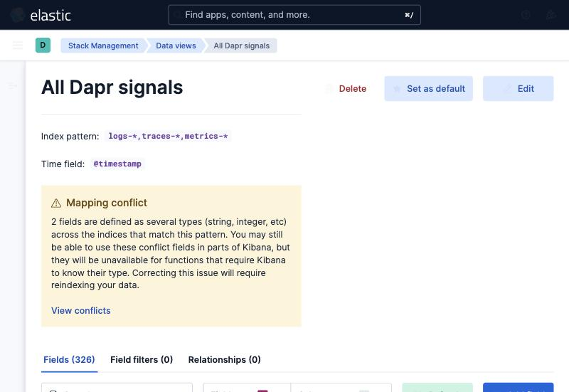
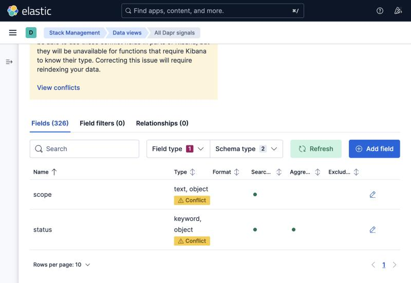

# dapr-elastic-correlation-lab

Dapr logs arrive in Elastic through the platform team's log shipper (`logs-*`);
traces and metrics arrive through an OTel collector (the APM streams). The usual
complaint is that the two "cannot be connected" and the logs need moving.

They don't. One Kibana data view takes a comma separated pattern.

Verified on Elasticsearch and Kibana 9.1.0 (free basic licence, no account) with
real Dapr 1.19.0 data from minikube.

## One view, three signals



`logs-*,traces-*,metrics-*` resolves 389 fields, an exact union of the three.
No merge, no reindex, no pipeline change.

One ES|QL query spans all three data streams, written by two different
collectors:


## The catch: mapping conflicts



Widening the pattern collides fields mapped differently on each side.

| pattern | fields | conflicts |
|---|---|---|
| `logs-*` | 50 | 0 |
| `traces-*` | 87 | 0 |
| `metrics-*` | 306 | 0 |
| `logs-*,traces-*` | 118 | 1 |
| `logs-*,traces-*,metrics-*` | 389 | 10 |

Only `scope` is truly unaggregatable (string in Dapr logs, object in OTel). The
other nine are `keyword` against `text` and go away once both sides map them the
same.

**This does not stop you charting.** Each pattern alone has zero conflicts and a
dashboard can mix panels from different views. Use the combined view to look
across signals, narrow views to chart.

## Correlating

Dapr sets `service.name` on the span to the app_id, so it lines up with the log
side for free. A span also carries `attributes.dapr.api` and
`attributes.dapr.status_code`, matching the `HTTP API Called` log line's `method`
and `code` exactly, so spans and access log lines join on service + API + status
+ time window.

Metrics join on `attributes.app_id`, **not** `service.name` — on a metric that
field is `daprd`, the scrape target.

There is still no `trace_id` on any Dapr log line, so true click through needs
<https://github.com/dapr/dapr/issues/10979>.

## Dashboard


`elastic/dapr-elastic-dashboard.ndjson`: API calls by status code, 5xx ratio,
p95 latency per Dapr API from the trace side, control plane log volume by scope.

**Edit the index patterns before importing.** They are this lab's
(`logs-dapr-default`, `traces-generic-default`); with the APM integration you
will have `traces-apm-*`. Otherwise it imports cleanly and shows nothing.

## Running it

Needs minikube and Docker. `KUBE_CONTEXT` and `ES_URL` override the defaults.

```bash
./scripts/setup.sh
```

Kibana at <http://localhost:5601>, then import the NDJSON under Stack
Management, Saved Objects.

    docker-compose.yml          Elasticsearch + Kibana
    k8s/                        tracing config, collector Deployment, workload
    elastic/                    dashboard, data views, index templates, queries
    scripts/harvest.py          stands in for the log shipper

## Traps

- **API logging is the access log.** Without `dapr.io/enable-api-logging: "true"`
  there are no `HTTP API Called` lines to correlate against.
- **`global.logAsJson` is control plane only.** The sidecar needs the
  `dapr.io/log-as-json` annotation. Neither implies the other.
- **The traffic driver must share the pod.** daprd binds `[::1],127.0.0.1`, so a
  driver in its own Deployment reaches nothing while looking correct.
- **No node access needed.** daprd pushes OTLP and its metrics endpoint is
  scraped in cluster, so a plain Deployment covers both. A DaemonSet is only for
  tailing files off the node, which is the log shipper's job.
- **Dapr histograms vanish without `cumulativetodelta`.** The Elasticsearch
  exporter drops every cumulative temporality histogram, taking
  `dapr_http_server_latency` with it, and says so only at `warn`. So the
  collector path and scraping Prometheus directly are not equivalent.
- **Don't add a `metrics-*` index template.** It shadows Elastic's
  `metrics-otel@template` and every metric document fails with an empty parse
  error. Only `logs-*` and `traces-*` need the ones in `elastic/`.
- **`_index` needs `METADATA _index`** in ES|QL.
- **Control plane logs are three formats**, even with JSON on: Dapr logger,
  scheduler zap cron (`logger`, not `scope`), operator klog plaintext. That is
  the blank scope row in the dashboard.

More detail in [FINDINGS.md](FINDINGS.md).
