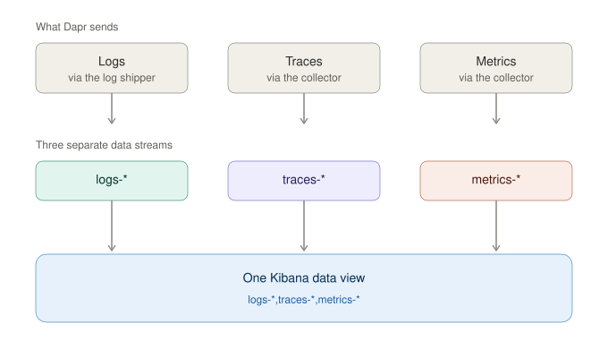
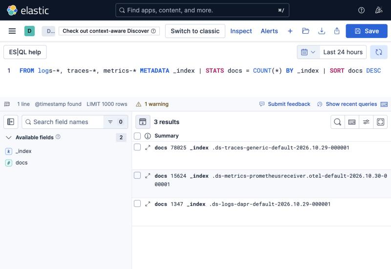
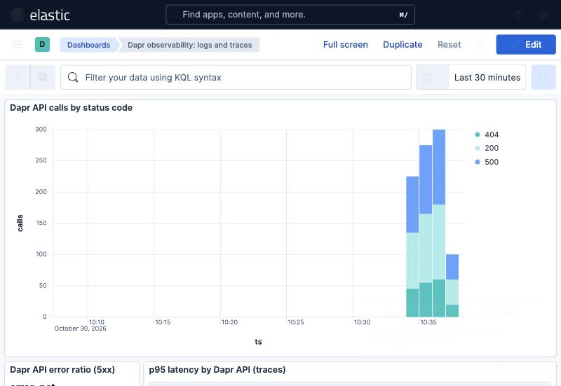

# dapr-elastic-correlation-lab

Dapr logs come in through a log shipper and land in `logs-*`. Traces and
metrics come in through an OpenTelemetry collector and land in the APM streams.
Two data views, so following anything across them means leaving one and
searching in the other.

## Combining them

A Kibana data view takes more than one index pattern. Stack Management, Data
Views, Create, and put all three in the index pattern field, comma separated:

    logs-*,traces-*,metrics-*

Use your real stream names. With the APM integration the traces one is
`traces-apm-*`.

Queries work across all three as well:

## Settings

On each pod template:

    dapr.io/enable-api-logging: "true"   # the HTTP API Called lines
    dapr.io/log-as-json: "true"          # sidecar JSON
    dapr.io/enable-metrics: "true"       # metrics are scraped off this

On the Dapr Helm release, for the control plane:

    global.logAsJson=true

`global.logAsJson` applies to the control plane and the pod annotation applies
to the sidecar, so set both.

In the log pipeline, parse the JSON conditionally. `dapr-system` emits three
formats: Dapr's own JSON, etcd zap JSON (`ts`, `caller`) from the scheduler,
and plaintext. Group control plane views on the container name, since `scope`
is absent on most scheduler lines.

In the metrics pipeline, add `cumulativetodelta`. Without it the Elasticsearch
exporter drops every Dapr histogram, including `dapr_http_server_latency`,
while counters keep arriving.

## Joining a span to its log lines

Dapr sets `service.name` on the span to the app_id. The span also carries
`attributes.dapr.api` and `attributes.dapr.status_code`, which match `method`
and `code` on the access log line. Metrics join on `app_id`.

Dapr log lines carry no `trace.id`, so Elastic's trace to logs click through in
the APM UI does not work. Tracked in
<https://github.com/dapr/dapr/issues/10979>.

## The lab

Elasticsearch and Kibana 9.1 in Docker, Dapr 1.19 on minikube, a test workload
and two collectors. `./scripts/setup.sh` starts it, `teardown.sh` removes it.

    k8s/        tracing config, collectors, workload
    elastic/    dashboard, data views, queries

The dashboard's index patterns are this lab's, so edit them before importing.
