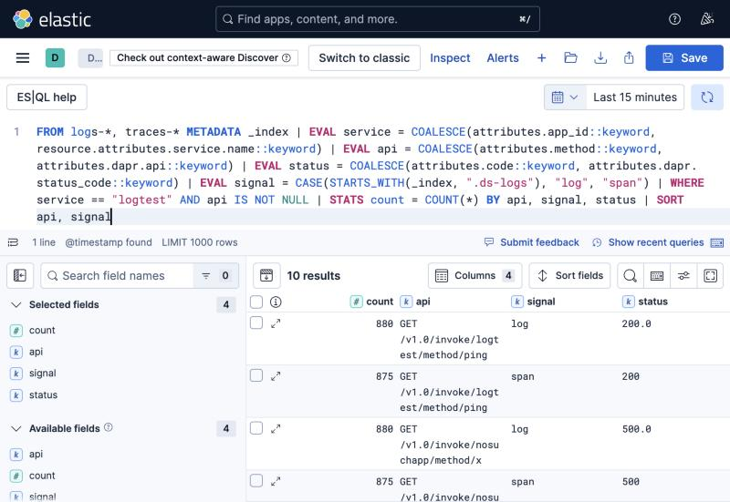

# dapr-elastic-correlation-lab

Dapr logs come in through a log shipper and land in `logs-*`. Traces and
metrics come in through an OpenTelemetry collector and land in the APM streams.
Two data views, so following anything across them means leaving one and
searching in the other.

## Combining them

A Kibana data view takes more than one index pattern. Stack Management, Data
Views, Create, and put all three in the index pattern field, comma separated:

    logs-*,traces-*,metrics-*

Use your real stream names. With the APM integration the traces one is
`traces-apm-*`.


One service across all three signals in a single query:


## Settings

On each pod template:

    dapr.io/enable-api-logging: "true"   # the HTTP API Called lines
    dapr.io/log-as-json: "true"          # sidecar JSON
    dapr.io/enable-metrics: "true"       # metrics are scraped off this

On the Dapr Helm release, for the control plane:

    global.logAsJson=true

`global.logAsJson` applies to the control plane and the pod annotation applies
to the sidecar, so set both.

In the log pipeline, parse the JSON conditionally. `dapr-system` emits three
formats: Dapr's own JSON, etcd zap JSON (`ts`, `caller`) from the scheduler,
and plaintext. Group control plane views on the container name, since `scope`
is absent on most scheduler lines.

In the metrics pipeline, add `cumulativetodelta`. Without it the Elasticsearch
exporter drops every Dapr histogram, including `dapr_http_server_latency`,
while counters keep arriving.

## Joining a span to its log lines

Dapr sets `service.name` on the span to the app_id. The span also carries
`attributes.dapr.api` and `attributes.dapr.status_code`, which match `method`
and `code` on the access log line. Metrics join on `app_id`.

Normalising those into common columns puts each API next to itself, once from
the log side and once from the span side:

```
FROM logs-*, traces-* METADATA _index
| EVAL service = COALESCE(attributes.app_id::keyword,
                          resource.attributes.service.name::keyword)
| EVAL api     = COALESCE(attributes.method::keyword,
                          attributes.dapr.api::keyword)
| EVAL status  = COALESCE(attributes.code::keyword,
                          attributes.dapr.status_code::keyword)
| EVAL signal  = CASE(STARTS_WITH(_index, ".ds-logs"), "log", "span")
| WHERE service == "logtest" AND api IS NOT NULL
| STATS count = COUNT(*) BY api, signal, status
| SORT api, signal
```



The counts differ because one request writes one access log line but several
spans. The `::keyword` casts are needed because the same field is mapped as
`keyword` in one stream and `text` in another.

Dapr log lines carry no `trace.id`, so Elastic's trace to logs click through in
the APM UI does not work. Tracked in
<https://github.com/dapr/dapr/issues/10979>.

## The lab

Elasticsearch and Kibana 9.1 in Docker, Dapr 1.19 on minikube, a test workload
and two collectors.

    docker compose up -d

    curl -X PUT localhost:9200/_index_template/lab-traces \
      -H 'Content-Type: application/json' \
      -d @elastic/index-templates/lab-traces.json

    kubectl --context minikube apply -f k8s/

The collectors write to `host.minikube.internal:9200`, so change that in
`k8s/10-otelcol.yaml` and `k8s/30-logcol.yaml` if you are not on minikube.

In Kibana, Stack Management, Saved Objects, import `elastic/dataviews.ndjson`
and `elastic/dapr-elastic-dashboard.ndjson`.

    k8s/        tracing config, collectors, workload
    elastic/    dashboard, data views, queries


The dashboard's index patterns are this lab's, so edit them before importing.
