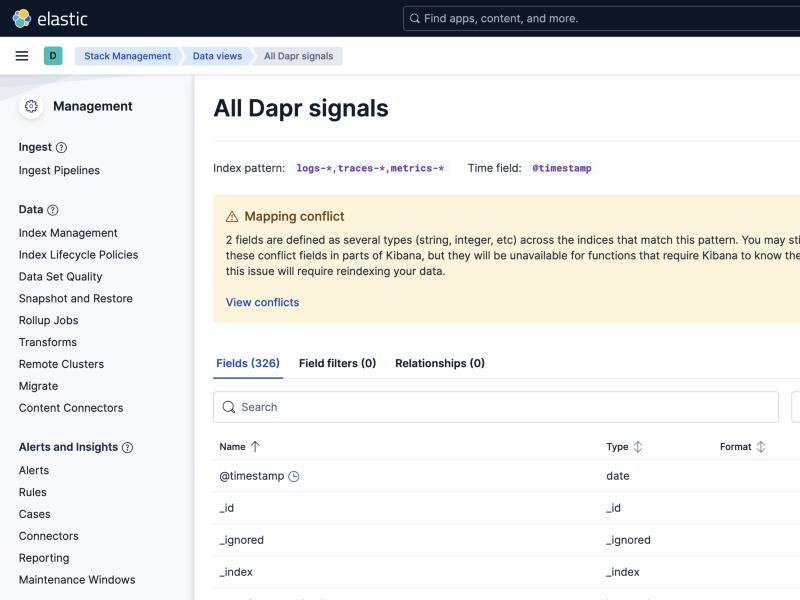
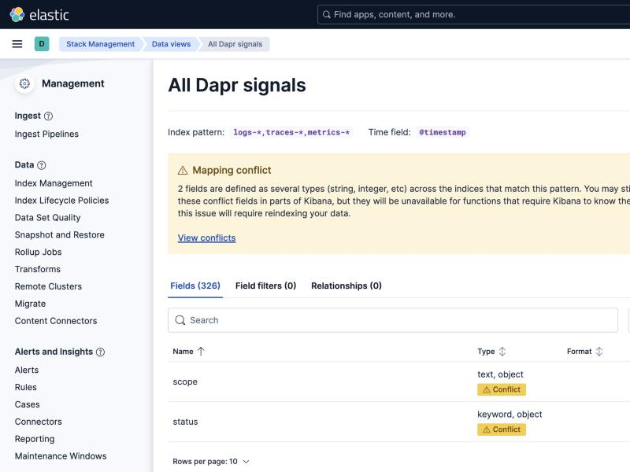
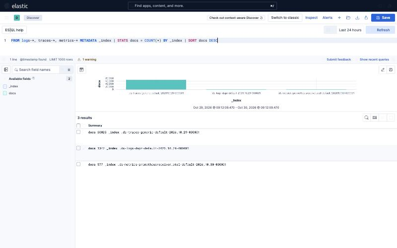
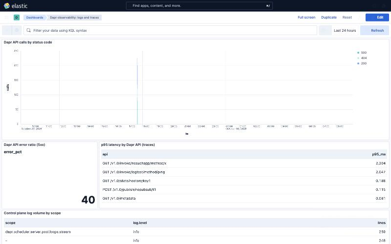

# Screenshots

All captured from the running lab, Kibana 9.1.0, against real Dapr 1.19.0 data.

## One data view across all three signals

Index pattern `logs-*,traces-*,metrics-*`, 326 fields. The three signals arrive
through three separate pipelines into three separate data streams, and one data
view resolves across all of them. No merge, no reindex, no pipeline change.

## The catch: mapping conflicts

Widening the pattern collides fields that are mapped differently on each side. A
conflicted field still displays but is unavailable for aggregations, so it
cannot be used in a visualisation or a `STATS ... BY`.

Measured with `_field_caps`:

| pattern | fields | conflicts |
|---|---|---|
| `logs-*` | 50 | 0 |
| `traces-*` | 87 | 0 |
| `metrics-*` | 306 | 0 |
| `logs-*,traces-*` | 118 | 1 (`scope`) |
| `logs-*,traces-*,metrics-*` | 389 | 10 |

The ten include `app_id`, `method` and `resource.attributes.service.name`, which
are exactly the fields the correlation depends on.

This is a mapping discipline problem rather than a limitation of the approach.
`scope` genuinely collides, Dapr logs use it as a string while OTel uses it as
an object for instrumentation scope, so one side needs renaming. The rest are
`keyword` against `text` and come from the log side being dynamically mapped
here; a log pipeline writing through a template that maps these as `keyword`
agrees with the OTel side and the conflicts go away.

## One ES|QL query spanning three data streams

    FROM logs-*, traces-*, metrics-* METADATA _index
    | STATS docs = COUNT(*) BY _index
    | SORT docs DESC

Three rows from three data streams written by two different collectors:
`traces-generic-default`, `logs-dapr-default` and
`metrics-prometheusreceiver.otel-default`. `METADATA _index` is required or
`_index` is an unknown column.

## Dashboard

The four panels in `elastic/dapr-elastic-dashboard.ndjson`: Dapr API calls by
status code, the 5xx error ratio, p95 latency per Dapr API from the trace side,
and control plane log volume by scope.

The API call series is a single spike because `harvest.py` loads logs once as a
batch rather than tailing them continuously. Trace and metric data is live. The
blank scope row in the bottom panel is real and is explained in FINDINGS.md.
